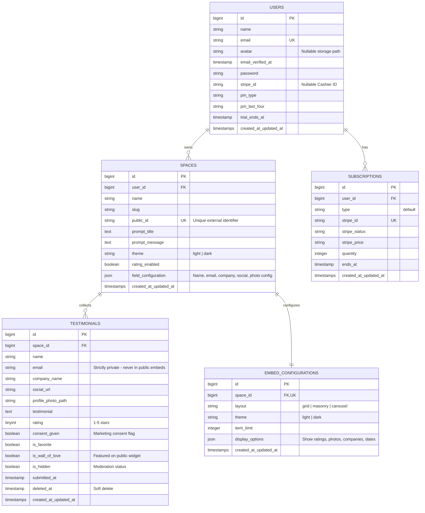

# Data Model & Entity Relationships — Testimonials SaaS

This document outlines the database schema, entity models, and relationships used across the Testimonials collection platform.

---

## 📊 Entity Relationship Diagram (ERD)

---

## 🔍 Key Entity Descriptions

### 1. `User`
- **Role**: Account owner who creates collection spaces and moderates feedback.
- **Billable**: Integrated with Laravel Cashier (`stripe_id`, `pm_type`, `pm_last_four`).
- **Profile**: Includes custom avatar path (`avatar`), 2FA secrets, and Passkeys.

### 2. `Space`
- **Role**: Dedicated branded container for collecting customer testimonials.
- **Security**: Features an unguessable `public_id` used for public collection (`/s/{public_id}`) and embed endpoints (`/embed/{public_id}`).
- **Configuration**: Stores dynamic field requirements and rating options in JSON.

### 3. `Testimonial`
- **Role**: Individual customer review submitted through a public space.
- **Privacy Guarantee**: `email` is never included in public queries or API scopes.
- **Moderation Workflow**: Controlled via `is_hidden`, `is_favorite`, `is_wall_of_love`, and `consent_given`.
- **Retention**: Utilizes `SoftDeletes` for accidental deletion recovery.

### 4. `EmbedConfiguration`
- **Role**: Customization options for rendering the public Wall of Love widget.
- **Display Options**: Controls layout (masonry, grid, carousel) and visual elements (photos, company badges, star ratings).
